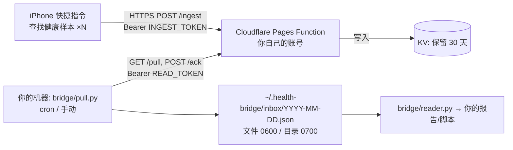
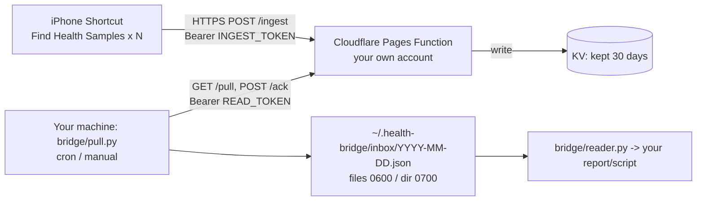

# health-bridge

**中文** | [English](#english)

把 iPhone 的 Apple Health 数据，**免费**、**不用第三方付费 App、不逆向**，每天送到你自己的电脑/服务器。
用 iOS 自带「快捷指令」读取健康数据 → POST 到你自己 Cloudflare 账号里的一个小中转（Pages Function + KV）→ 你的机器定时拉取成按天命名的 JSON 文件。中转带存储，你的机器离线时数据也不会丢。

## 架构



- **两个令牌**：`INGEST_TOKEN` 放手机（只能写入），`READ_TOKEN` 留在你的机器（只能拉取和确认）。手机丢了也读不到历史数据。
- 数据只经过你自己的 Cloudflare 账号，本项目没有任何中心服务器。
- 免费额度足够：每天几次写入，远低于 KV 免费版的限制。

## 目录

| 路径 | 说明 |
|---|---|
| `worker/` | Cloudflare Pages Functions：`/ingest` `/pull` `/ack` `/health` |
| `scripts/deploy.py` | 一键部署（建 KV、绑定、生成令牌、设为 secret、部署、自测） |
| `scripts/selftest.py` | 端到端自测 |
| `bridge/pull.py` | 从中转拉取，写成 `inbox/YYYY-MM-DD.json` |
| `bridge/reader.py` | 容错解析器，`load_day()` 返回规范化数据 |
| `docs/SCHEMA.md` | JSON 格式（简化版 / 完整版） |
| `examples/` | 样例导出文件 |
| `shortcuts/` | 导出的 `.shortcut` 文件说明位 |
| `tests/` | 解析器与落盘逻辑的单元测试 |

## 部署（约 5 分钟）

需要：Node.js、Python 3.9+、一个免费 Cloudflare 账号。

1. 登录 Cloudflare，二选一：
   - `npx wrangler login`（浏览器授权），或
   - 创建 API Token（权限：Account → Cloudflare Pages: Edit，Account → Workers KV Storage: Edit），然后
     `export CLOUDFLARE_API_TOKEN=...`、`export CLOUDFLARE_ACCOUNT_ID=...`
2. `git clone` 本仓库，进入目录，运行：
   ```bash
   python3 scripts/deploy.py --timezone Asia/Shanghai     # 时区用于给「每天一个文件」划分日期
   # 可选：--project 自定义项目名；--data-dir 指定数据目录；--dry-run 只预览不改动
   ```
3. 脚本会：生成两个令牌写入 `~/.health-bridge/config.env`（0600）并设为 Pages secret → 创建 KV 与 Pages 项目 → 部署 → 等待 `/health` → 跑自测（全部 PASS 才算成功）。
4. 记下输出的 **Ingest URL**（`https://<项目>.pages.dev/ingest`）。令牌在 `config.env` 里的 `INGEST_TOKEN`，**不要贴到聊天或截图里**。
5. 定时拉取（任选）：`crontab -e` 加一行 `15 9 * * * python3 /path/to/health-bridge/bridge/pull.py`；或在生成报告前调用 `reader.refresh()`。
6. 重新生成令牌：`python3 scripts/deploy.py --rotate`（之后要更新手机上的令牌）。

## iPhone 快捷指令搭建

下面是**简化版（4 个操作）**：VO2max、步数、活动能量。其他指标照同样方式加「查找健康样本」+ JSON 里多一个键即可（见 `docs/SCHEMA.md`）。操作名「中文 / English」。

1. **查找健康样本 / Find Health Samples** → 类型 `最大摄氧量 / VO2 Max`，排序 `开始日期 / Start Date`、`最新优先 / Latest First`，开启 **限制 / Limit = 1**。
2. **查找健康样本** → 类型 `步数 / Steps`，开始日期 `在过去 1 天 / is in the last 1 day`。
3. **查找健康样本** → 类型 `活动能量 / Active Energy`，开始日期 `在过去 1 天`。（建议加筛选「来源 Source 是 Apple Watch」，见下面的坑。）
4. **获取 URL 内容 / Get Contents of URL**（点「显示更多」）：
   - URL：`https://<你的项目>.pages.dev/ingest`
   - 方法：`POST`
   - 标头：`Authorization` = `Bearer <INGEST_TOKEN>`（Bearer 后一个空格）
   - 请求正文：`JSON`，添加 3 个键（类型选「文本」），值点选对应变量：
     `vo2max` ← 第 1 步的输出；`steps` ← 第 2 步的输出；`active_energy` ← 第 3 步的输出。
   值是换行分隔的样本，如 `"412 count\n1,208 count"`，解析器会处理。

成功标志：运行后返回 `{"ok":true,...}`；之后在你的机器上 `python3 bridge/pull.py` 应显示 `pulled 1 item(s)`。

### 每天自动运行
快捷指令 → 自动化 → ＋ → 个人自动化 → 例如「特定时间 08:30、每天」→ 添加「运行快捷指令」→ 选你的快捷指令 → 下一步 → **选「立即运行 / Run Immediately」**，并**关闭「运行时通知」**。不选「立即运行」，它只会弹通知等你点。

### 已踩过的坑
- **变量要选对应操作的输出**：3 个「查找健康样本」的输出名字都叫「健康样本」，很容易给 `steps` 键选成别的操作的结果。点开变量逐个确认来源；分不清就在每个 Find 后面加「设定变量」并起名 `vo2max` / `steps` / `active_energy`（总共 7 个操作，更保险）。
- **允许共享大量数据**：步数、活动能量样本多，首次运行 iOS 会问是否允许共享大量数据，要选**允许**。否则请求可能被拦。
- **健康权限**：第一次运行会逐项询问读取哪些健康数据，全部选允许；以后在 设置 → 健康 → 数据访问与设备 → 快捷指令 里可改。
- **锁屏读不到健康数据**：iPhone 锁屏时 HealthKit 受保护，快捷指令会拿到空结果。纯定时（08:30）可能正好锁屏。建议再加一个自动化：「起床 / 闹钟被停止 / 断开充电器」时运行同一个快捷指令。空导出不会覆盖同一天里有数据的导出。
- **活动能量（和步数）多来源重复**：iPhone、Apple Watch、第三方 App 各记一份，直接求和会重复。在「查找健康样本」里加筛选「来源 是 Apple Watch」（或你信任的单一来源）。
- 令牌写在快捷指令里：不要分享带令牌的快捷指令文件；怀疑泄露就 `--rotate`。

### 导出 .shortcut 文件
见 `shortcuts/README.md`（说明位，暂未发布文件）。

## 读取数据

```python
import sys; sys.path.insert(0, "/path/to/health-bridge/bridge")
from reader import load_day, refresh
refresh()                 # 可选：先拉取
d = load_day()            # 最新一天；load_day("2026-01-15")
print(d["metrics"]["steps"]["sum"], d["metrics"]["vo2max"]["last"])
```
简化版与完整版字段都支持，缺失的指标 `n = 0`、统计值为 `None`。详见 `docs/SCHEMA.md`。

## 安全说明
- 令牌只存在于：你本机 `config.env`（0600）、Cloudflare Pages secret、你手机的快捷指令。**不要提交 `config.env`**（`.gitignore` 已排除）。
- `/ingest` 只接受 `INGEST_TOKEN`；`/pull` 和 `/ack` 只接受 `READ_TOKEN`；比较使用哈希后的常量时间比较。
- 中转不记录请求内容。KV 里的数据 30 天后自动过期，被你的机器拉取并确认后立即删除。
- 健康数据是敏感数据：`inbox/` 目录 0700、文件 0600。别把 `inbox/` 同步到公开位置。
- 请求体上限 512 KB，必须是 JSON 对象。
- 默认的 `*.pages.dev` 域名是公开可访问的，安全性靠令牌，不靠地址保密。令牌 160 位随机。
- 提交 issue 或分享日志前，先确认没有令牌、账号 ID、KV namespace id 或个人健康数据。

## 开发
```bash
python3 -m unittest discover -s tests -v     # 解析器与落盘单元测试
cd worker && npx wrangler pages dev public --kv HEALTH_KV --binding INGEST_TOKEN=a READ_TOKEN=b   # 本地跑 Functions
```

## 许可
MIT，见 `LICENSE`。

---

<a id="english"></a>
# English

[中文](#health-bridge)

Send your iPhone's Apple Health data to your own computer or server every day — **free**, with **no paid third-party app and no reverse engineering**. An iOS Shortcut reads Health data and POSTs it to a tiny relay in *your own* Cloudflare account (Pages Function + KV); your machine pulls it on a schedule into one JSON file per day. The relay stores the data, so nothing is lost while your machine is offline.

## Architecture



- **Two tokens:** `INGEST_TOKEN` lives on the phone (write-only); `READ_TOKEN` stays on your machine (pull + ack only). A lost phone cannot read your history.
- Data only passes through your own Cloudflare account; there is no central server.
- The free tier is plenty: a few writes per day.

## Layout

| Path | What |
|---|---|
| `worker/` | Cloudflare Pages Functions: `/ingest` `/pull` `/ack` `/health` |
| `scripts/deploy.py` | one-command deploy (KV, binding, tokens, secrets, deploy, self-test) |
| `scripts/selftest.py` | end-to-end self-test |
| `bridge/pull.py` | pulls from the relay into `inbox/YYYY-MM-DD.json` |
| `bridge/reader.py` | tolerant parser; `load_day()` returns normalized data |
| `docs/SCHEMA.md` | JSON format (simple and full) |
| `examples/` | sample exports |
| `shortcuts/` | placeholder for an exported `.shortcut` file |
| `tests/` | unit tests for the parser and storage logic |

## Deploy (~5 minutes)

You need Node.js, Python 3.9+ and a free Cloudflare account.

1. Authenticate with Cloudflare, either:
   - `npx wrangler login` (browser OAuth), or
   - create an API token (Account → Cloudflare Pages: Edit, Account → Workers KV Storage: Edit) and
     `export CLOUDFLARE_API_TOKEN=...` `export CLOUDFLARE_ACCOUNT_ID=...`
2. Clone this repo and run:
   ```bash
   python3 scripts/deploy.py --timezone Europe/Berlin    # timezone decides which day a sample file belongs to
   # optional: --project NAME, --data-dir DIR, --dry-run (preview only)
   ```
3. The script generates two tokens into `~/.health-bridge/config.env` (0600) and stores them as Pages secrets, creates the KV namespace and Pages project, deploys, waits for `/health`, then runs the self-test (every check must PASS).
4. Note the printed **Ingest URL** (`https://<project>.pages.dev/ingest`). The token is `INGEST_TOKEN` in `config.env` — **never paste it into chats or screenshots**.
5. Schedule pulling, e.g. `15 9 * * * python3 /path/to/health-bridge/bridge/pull.py`, or call `reader.refresh()` before building a report.
6. New tokens: `python3 scripts/deploy.py --rotate` (then update the phone).

## iPhone Shortcut

**Simple version (4 actions):** VO2 Max, steps, active energy. For other metrics add another *Find Health Samples* and one more JSON key (see `docs/SCHEMA.md`).

1. **Find Health Samples** → Type `VO2 Max`, sort by `Start Date`, `Latest First`, turn on **Limit = 1**.
2. **Find Health Samples** → Type `Steps`, Start Date `is in the last 1 day`.
3. **Find Health Samples** → Type `Active Energy`, Start Date `is in the last 1 day`. (Adding a filter *Source is Apple Watch* is recommended; see pitfalls.)
4. **Get Contents of URL** (tap *Show More*):
   - URL: `https://<your-project>.pages.dev/ingest`
   - Method: `POST`
   - Headers: `Authorization` = `Bearer <INGEST_TOKEN>` (one space after Bearer)
   - Request Body: `JSON`, add 3 keys (type *Text*), each value a variable:
     `vo2max` ← output of step 1; `steps` ← output of step 2; `active_energy` ← output of step 3.
   Values are newline-separated samples such as `"412 count\n1,208 count"`; the parser handles them.

Success: the run returns `{"ok":true,...}`; then `python3 bridge/pull.py` on your machine prints `pulled 1 item(s)`.

### Run it daily
Shortcuts → Automation → + → Personal Automation → e.g. *Time of Day 08:30, Daily* → add *Run Shortcut* → pick your shortcut → Next → choose **Run Immediately** and turn **Notify When Run** off. Without *Run Immediately* it only shows a notification and waits for a tap.

### Pitfalls we hit
- **Pick the output of the matching action.** All three *Find Health Samples* outputs are called "Health Samples", so it is easy to wire the wrong one into a key. Tap each variable and check where it comes from; if unsure, add *Set Variable* after each Find (`vo2max` / `steps` / `active_energy`) — 7 actions total, safer.
- **Allow sharing large amounts of data.** Steps and active energy contain many samples; on first run iOS asks whether to allow sharing a large amount of data — choose **Allow**, otherwise the request may be blocked.
- **Health permissions.** The first run asks for each data type; allow them all. Change later in Settings → Health → Data Access & Devices → Shortcuts.
- **A locked iPhone returns no Health data.** HealthKit is protected while locked, so a pure 08:30 timer may run while locked. Add a second automation on *Wake Up / Alarm stopped / Charger disconnected* that runs the same shortcut. An empty export never overwrites a same-day export that has data.
- **Active energy (and steps) are duplicated across sources.** iPhone, Apple Watch and third-party apps each record their own; a plain sum double counts. Add a *Source is Apple Watch* (or your single trusted source) filter to the Find action.
- The token is stored inside the shortcut: don't share a shortcut file that contains it; if in doubt, `--rotate`.

### Exporting the .shortcut file
See `shortcuts/README.md` (placeholder; no file published yet).

## Reading the data

```python
import sys; sys.path.insert(0, "/path/to/health-bridge/bridge")
from reader import load_day, refresh
refresh()                 # optional: pull first
d = load_day()            # newest day; load_day("2026-01-15") for a specific one
print(d["metrics"]["steps"]["sum"], d["metrics"]["vo2max"]["last"])
```
Both the simple and the full export are supported; missing metrics have `n = 0` and `None` stats. See `docs/SCHEMA.md`.

## Security notes
- Tokens exist only in your local `config.env` (0600), as Cloudflare Pages secrets, and inside your phone's shortcut. **Never commit `config.env`** (it is in `.gitignore`).
- `/ingest` accepts only `INGEST_TOKEN`; `/pull` and `/ack` accept only `READ_TOKEN`; comparison is constant-time over hashes.
- The relay does not log request bodies. KV entries expire after 30 days and are deleted as soon as your machine acks them.
- Health data is sensitive: `inbox/` is 0700, files 0600. Don't sync `inbox/` to public places.
- Request bodies are capped at 512 KB and must be JSON objects.
- The default `*.pages.dev` hostname is public; security rests on the tokens (160 random bits), not on a secret URL.
- Before filing an issue or sharing logs, remove tokens, account IDs, KV namespace ids and personal health data.

## Development
```bash
python3 -m unittest discover -s tests -v
cd worker && npx wrangler pages dev public --kv HEALTH_KV --binding INGEST_TOKEN=a READ_TOKEN=b   # run the Functions locally
```

## License
MIT, see `LICENSE`.
